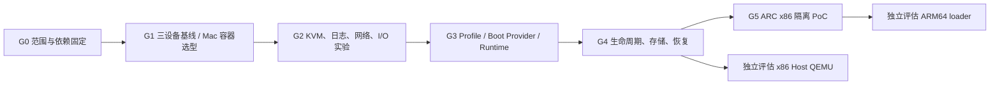

# DockDSM 运行架构与性能实施计划

本文件固定工作包、依赖和退出条件；执行状态只在 [CONTEXT](../CONTEXT.md) 更新。设计依据是维护者指定的[项目分析对话](https://chatgpt.com/share/6ad9a9ea-a228-83ea-9c94-b4c2aaadc0fa)与 2026-10-22 源码快照 tag `refs/tags/evidence/2bebdb2`（解引用为 `2bebdb2`；该根提交已被当前根提交取代，证据边界见 [PROVENANCE](PROVENANCE.md#已重建根提交的证据边界)）。本轮交付为规划文档，不实现控制器、启动配置或性能补丁。

## 方向与边界

采用“局部性能实验起步，逐步重构运行架构”的路线。保留 DSM 硬件兼容、安装校验、QEMU 补丁及现有回归；把平台描述、启动提供者、运行后端、存储和生命周期逐步分离。ARC 是可选 Boot Provider，ARM64 direct boot 保留，详见 [ADR 0006](ADR/0006-runtime-profiles-and-container-first.md)。

- x86、MacBook Air M5、RK3588 为首批设备；具体组合与预检见[测试矩阵](test-matrix.md)。拥有设备不代表该组合已通过验收。
- RK3588 只允许 Docker 容器验证，所有探针、QEMU、负载和采集工具在容器/其 DSM guest 内执行；不安排 Host QEMU、宿主工具安装、内核替换或宿主桥接改造。
- Mac 以最佳容器化体验为目标：比较外层容器后端、内层加速及存储路径；保留 KVM 兼容，不预设 KVM、VZ 或 Docker VMM 标签能单独代表胜出，见 [Mac 选型](mac-container-evaluation.md)。
- 首批交付为本地单机 CLI 与 Docker 路径；API/Web、多用户控制、Host QEMU、libvirt、ARM64 loader 均有独立后续门槛。
- 旧盘不自动迁移。任何新 profile、存储格式、ARC 实验均使用独立空目录或已停机的一次性副本。

## 源码审查得到的工作入口

以下为上述 SHA 的事实快照，不是已测得的性能瓶颈。

| 位置 | 可确认的实现 | 对应工作包 |
| --- | --- | --- |
| [entry.sh](../src/entry.sh)、[common.sh](../src/platform/common.sh) | source 串联基础镜像脚本；平台白名单只有两项 | W30–W32：保留旧路径对照，抽取类型化契约 |
| [compose.local.yml](../compose.local.yml) | 默认 `KVM=N`、2 vCPU / 2G、loopback 端口 | W10、W20：记录实际加速，另设显式性能配置 |
| [rtd1619b.sh](../src/platform/rtd1619b.sh) | KVM 失败可回退 TCG；USB NIC + user NAT；详细内核日志；AHCI/raw | W20–W23：逐变量实验，保留硬件兼容参数 |
| [check.sh](../src/check.sh) | 无 PID/地址时可返回成功；HTTP 检查不证明配置与卷就绪 | W11、W41：区分存活、启动、管理、存储证据 |
| [arm-lifecycle.py](../src/platform/arm-lifecycle.py)、[power.sh](../src/power.sh) | 有退出观察；ARM 缺少主动 guest shutdown agent | W40：请求与结果分离，单一 QMP 会话所有者 |
| [Dockerfile](../Dockerfile) | 基础镜像用标签，patology 来自 main；各宿主镜像包含两种 guest QEMU | W01、W43：先固定供应链，再有条件拆分产物 |

## 阶段与依赖

G0 的依赖盘点可与 G1 设备预检并行；G2 单项实验互相独立。这里指工作依赖，不要求启用多代理或同时占用设备。网络、磁盘、QEMU 版本变更不放进同一次对照。

| Gate | 交付与退出条件 | 失败后处理 |
| --- | --- | --- |
| G0 可重复输入 | 宿主架构、PAT、两类 QEMU、镜像、工具来源有锁定清单；现有自动门禁通过 | 缺失身份时不发布结果；禁止用 main/latest 变化解释为产品优化 |
| G1 基线 | X1/M1/R1 三个主组合分别完成预检和可重复基线；Mac 候选完成资格筛选及有效对照 | 无 KVM/容量不足记为设备阻断；可继续其它组合，不能宣称全矩阵完成 |
| G2 局部优化 | 每个保留候选有 A/B 结果、兼容与数据门禁；无收益项也保留结论 | 退回该变量；不扩大修改范围“救”跑分 |
| G3 分层等价 | 两个既有 profile 的计划/argv 等价、失败输入明确；旧入口仍可回退 | 旧执行器继续默认；禁止同时更换设备/磁盘布局 |
| G4 可恢复运行 | 正常/强制退出可区分；旧盘兼容、锁、元数据事务、备份恢复通过主矩阵；24h 稳定性通过 | 不切换默认控制器；数据失败阻断该发布候选 |
| G5 扩展性 | ARC x86 经新接口隔离安装、持久化、关机与恢复；新增 profile 不改其他 profile 安装逻辑 | ARC 保持实验项；不阻断既有平台独立发布 |

G1–G4 的三设备闭环是本路线首个工程完成目标；Mac 的最终候选与 M1 基准分别留证。ARM64 loader 不作为首个目标的依赖。未经证据不承诺具体提速倍数或日历发布日期。

## 可分派工作包

责任域沿用 [MAINTAINERS](MAINTAINERS.md)。所有条目均为计划，后续一个 PR 处理一个主题，不在本轮创建外部 issue 或 PR。

| ID / 优先级 | 工作与具体交付 | 依赖 | 验收 / 责任域 |
| --- | --- | --- | --- |
| W00 / P0 | 三设备登记：OS、CPU、RAM、磁盘、网卡、容器引擎、权限、固件/内核可见信息 | 无 | 矩阵每个必填项有值或明确未知；Product / Platforms |
| W01 / P0 | 锁定基础镜像 digest、qemu-host、patology commit/hash、QEMU source/patch、Python 依赖；形成更新流程 | 无 | 输入清单见[依赖固定](dependency-locks.md)；仓库身份可验证，系统包与构建子项目保留未验证边界；原生 amd64/arm64 CI；CI / Release |
| W10 / P0 | 执行 X1/M1/R1 预检、现有两 profile 基线和跨架构诊断；保存完整环境 manifest | W00、W01 | [性能协议](performance-baseline.md)字段与重复次数齐全；Platforms / Quality |
| W11 / P0 | 定义并采集 QEMU started、HTTP、configured、volume healthy 的独立时间点 | W10 | 不把 Docker healthy 当作 DSM ready；ARM runtime |
| W12 / P0 | Mac M1/M2/M3/M4 容器候选资格筛选、A/B、恢复验证，写选择报告 | W00、W01 | 与 M1 同一 guest/PAT/QEMU；容器化优先，结果可复现；Platforms |
| W20 / P0 | portable / native-kvm 两种显式部署意图；结构化报告 request/actual/fallback | W10 | KVM 性能档失败即止；原有 ENV 行为保留兼容；Platforms |
| W21 / P1 | 普通/详细日志分离，逐项验证 debug cmdline | W10、W11 | 可观察到必要启动/错误/关机；冷启动 A/B；ARM runtime |
| W22 / P1 | 保留 USB CDC，仅替换 user/TAP 后端做隔离实验 | W10 | 网络收益、权限清单、失败清理；RK 不改宿主桥接；Platforms |
| W23 / P1 | AHCI/raw 不变，对 cache、AIO、存储落点逐项实验 | W10 | fsync/持久性/副本恢复及 I/O 对照；ARM runtime |
| W30 / P1 | versioned Profile / VMConfig / HostCapabilities / LaunchPlan schema 和校验器 | G2 | 未知字段/版本失败；白名单能力，无任意 Shell；Platforms |
| W31 / P1 | Python 只读计划与 argv 构建；legacy adapter 对照 | W30 | 两 profile 快照、边界输入和实际镜像命令一致；Platforms |
| W32 / P1 | 受控切换 Docker runtime adapter；保持旧入口和回退路径 | W31 | X1/M1/R1 冷启动不改硬件契约；Platforms |
| W40 / P0 | 生命周期、单一 QMP owner、关机请求接口；DSM 授权 API 可行性先行 | W32 | 无凭据/错误凭据/超时不假报 clean；TD-001 有真实闭环；ARM runtime |
| W41 / P0 | 就绪状态分维度、带时间与证据；采集失败为 unknown | W11、W40 | HTTP 200/旧缓存不提升 configured/volume；Quality |
| W42 / P0 | 新状态布局、独占锁、原子代次发布；旧盘适配与离线恢复 | W32、W40 | 并发启动、断电副本、未知 schema、空间不足不替换旧盘；ARM runtime |
| W43 / P2 | 按 guest 拆分 runtime 产物，控制层是否独立打包由实测决定 | W01、G4 | 构建时间/镜像大小/更新维护收益明确；保留双宿主架构；CI / Release |
| W50 / P1 | 固定 ARC 组件，独立 `arc-x86` profile PoC | G4、RISK-006 组件审查 | [ARC 门禁](arc-integration.md)；Product / Platforms |
| W60 / P2 | x86 Linux Host QEMU 接口适配评估 | G4 | 同硬件对照证明管理需求；RK 排除；Platforms |
| W61 / P2 | ARM64 loader 可行性与维护成本报告 | G5 | 构建/交接/设备/许可矩阵，无收益则暂缓；Platforms |
| W62 / P2 | 新 QEMU 版本与 TCG 热点实验 | G2、独立 ADR | 四补丁语义与 DC ZVA 合成/真实回归，无 watchdog 放宽；QEMU / TCG |

## 实施与回退规则

1. 后续开发先做 W00/W01/W10/W12；不先批量搬目录、重写驱动或引入 Web 服务。
2. 优化与重构分别留对照：G2 可改变一个运行选项；G3 只改变组织形式。发生性能回归时能确定是哪个变量导致。
3. 控制器灰度先用于新建试验 VM。旧存储由 legacy adapter 原路径打开，首启不重命名、不重分区、不自动转 qcow2。
4. 回退必须配对恢复控制器、profile、镜像和元数据备份；若磁盘已由新 DSM 修改，不能只退镜像标签。数据库或磁盘跨版本回退需要停机备份恢复证据。
5. 缺少真实设备证据时允许推进静态设计及其它主机工作，但该设备行保持未验证；发布范围必须排除它。
6. [CI](ci.md)保留现有合成门禁；私有 PAT 和硬件测试不进入公共 PR runner。人工触发的专用设备测试仅运行已审查 SHA，采用一次性数据与最小权限。

## 规划交付清单

- [架构契约](runtime-architecture.md)：职责、接口、状态、存储、兼容与分发。
- [三设备测试矩阵](test-matrix.md)：宿主、guest、加速器、执行边界及证据。
- [Mac 容器后端选型](mac-container-evaluation.md)：候选资格、性能取舍与决策方法。
- [性能基线协议](performance-baseline.md)：负载、测量、重复性与判定。
- [ADR 0006](ADR/0006-runtime-profiles-and-container-first.md)：替代统一 ARC 路线的长期决定。

设备接入地址、x86 CPU/OS、RK3588 板型/内核/存储、三台 RAM 和 Mac 软件版本均在 W00 执行时补齐；这些未知项不妨碍本轮完成规划，也不会被写成已验证能力。
