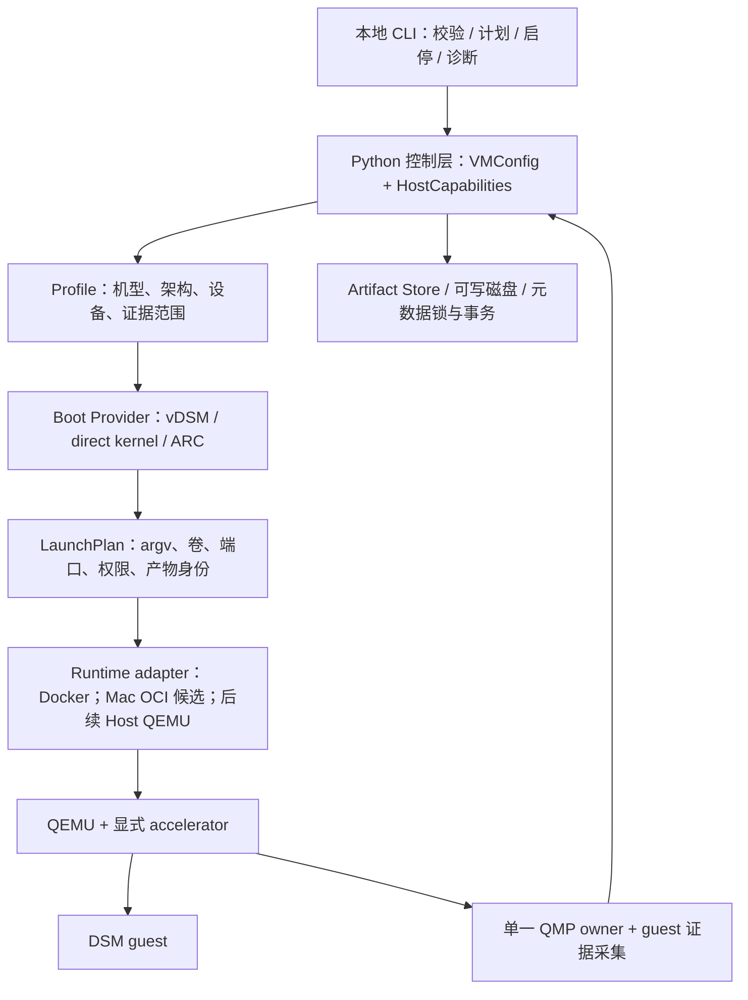

# DockDSM 运行架构设计

设计中；以下类型、接口、目录与操作名均为后续实现契约，不是现有 CLI 或配置语法。范围与顺序见 [ADR 0006](ADR/0006-runtime-profiles-and-container-first.md)和[实施计划](implementation-plan.md)，现有公开接口仍以 [platforms](platforms.md) 为准。

## 分层与数据流



同一 VM 的 loader 和 DSM 是不同启动阶段。Mac 的 Linux 容器外层 VM 是另一个环境层，不可与 loader 混同。Host/容器镜像/guest 三种架构单独声明；运行 amd64 用户空间翻译不等于加速 x86 DSM 内核。

| 模块 | 负责 | 不负责 / 输入限制 |
| --- | --- | --- |
| 控制层 | 本地单 VM 操作、配置校验、操作 ID、锁、调用和诊断 | 不在首批提供 Web 服务，不直接执行用户 Shell |
| Profile | 固定模型、guest 架构、机器/设备、驱动前提、可用启动方式和支持边界 | 不隐含授权，不因宿主 CPU 自动换 DSM 型号 |
| Boot Provider | 官方输入校验、安装产物、引导介质/内核交接、loader 状态 | 不决定容器权限或覆盖已有 runtime disk |
| Runtime adapter | 受控创建/启动/观察/停止容器或进程，返回实际 argv/退出原因 | 不下载 PAT，不解释 DSM configured，不选择其他 profile |
| 存储层 | 产物身份、VM 独占、代次发布、盘布局验证与离线恢复 | 不把运行盘当作不可变 seed，不对在线 QEMU 盘做修复 |
| 观察与生命周期 | QMP 事件、进程身份、guest 状态、证据时效和关机结果 | 不用 HTTP 可达冒充卷就绪，不伪造 guest shutdown |

## 类型和操作契约

使用 versioned JSON Schema 描述文件边界，Python 类型承载内部结构；如接受 YAML，先转成同一校验模型并拒绝重复键。首批仅加载仓库内白名单 profile，不加载外部可执行插件。标识符沿用 `virtualdsm` / `rtd1619b`，未来 `arc-x86` 在实现前不是合法 `DSM_PLATFORM`。

| 类型 | 必填字段与约束 |
| --- | --- |
| Profile | schema_version、id、guest_arch、boot_provider、machine、devices、允许 accelerator、DSM/PAT 身份策略、兼容证据范围 |
| VMConfig | vm_id、profile_id、runtime_adapter、storage_ref、资源、网络意图、acceleration 意图；未知字段拒绝 |
| HostCapabilities | 外层 OS/架构/VMM、容器架构、KVM 节点/权限/初始化、QEMU hash/features、卷后端、可用网络能力；每项有时间 |
| LaunchPlan | config/profile/input 摘要、实际 argv 数组、卷和端口列表、最小权限、选定 accelerator、回退原因、前置检查和计划 hash |
| Observation | run_id、launch_generation、进程/容器身份、观测时间、来源、值、失败原因；过期数据不表示实时健康 |
| OperationResult | operation_id、状态、错误类别、是否产生写入、恢复建议、证据引用；输出脱敏 |

拟议操作为 validate、plan、start、inspect、request_shutdown、wait_stopped、diagnose、backup/restore。plan 不创建磁盘、不拉镜像、不联网取 PAT、不启动容器；start 在独占锁内重新验证计划和输入，避免计划与执行之间资源变化。重复 start 返回当前实例或明确冲突，不启动第二个写盘进程。

argv 通过列表传递，禁止 eval/字符串 Shell。QEMU 选项内的逗号、路径、端口、设备 ID 按各自语法校验，数组不能自动解决 QEMU 子语法转义。保留现有 ARM 对自由 `ARGUMENTS`/QMP/MONITOR 覆盖的拒绝行为。

## 加速、网络与性能配置

- `portable` 是拟议意图：明确 TCG，用于兼容/诊断，不承诺跨架构高性能。
- `native-kvm` 是拟议严格意图：同架构、容器可访问设备、所选生产 QEMU machine/CPU 初始化成功；任一失败即止。它不等于直接改写现有 `KVM=Y` 含义。
- 旧 ENV 通过 legacy adapter 保留行为；其 TCG fallback 必须结构化记录。新的宽松 auto 如需加入，应显式选择并报告 actual/fallback。
- 网络 `backend` 与 `device` 分离，先 USB CDC + user/TAP 对照，再考虑驱动适配。Mac 外层转发、容器 NAT 和 QEMU NAT 分别记录。
- 网络资源具备 owner、run_id 与清理账本；仅清理本次创建的资源。RK 只允许容器网络命名空间内的动作，不能借 `--privileged`、host network 或宿主 root 挂载突破边界。
- 不预设 Docker 性能低于 Host QEMU；同加速器条件下先测量，再决定是否需要第二个 runtime。

## 生命周期与就绪证据

进程生命周期与 guest 就绪是两套数据。生命周期为 CREATED → STARTING → ACTIVE → STOP_REQUESTED → STOPPED，异常进入 FAILED 或 RECOVERY_REQUIRED；启动中即可失败，重启可能使 guest 就绪倒退。ACTIVE 只说明 VM 进程存在。

就绪维度分别为 loader_ready、kernel_booted、management_reachable、admin_initialized、dsm_configured、services_ready、volume_healthy。每项为 true/false/unknown 并附时间、来源；未取到授权管理证据时为 unknown。运行状态展示由 profile 所需维度计算，不能仅用固定线性状态推进，也不能把 legacy healthcheck 成功直接映射为 RUNNING。

| 事件 | 处理 | clean 判定 |
| --- | --- | --- |
| 用户通过 DSM UI/API 正常关机 | 记录 guest 事件、退出码、文件系统卸载与代次收据 | ARM 仍要求 guest=true、reason=guest-shutdown、QEMU rc=0 |
| 控制器请求关机 | profile 选择已验证的授权 API/协作通道；先记录 request | 请求成功不代表完成，等待真实结果 |
| 凭据过期/缺失或 API 不支持 | 返回 actionable 错误或等待 UI；不自动绕过认证 | unknown/未完成，不伪报成功 |
| 容器 stop 超时、QMP quit、SIGTERM/SIGKILL | 记录 host-directed/timeout/forced，保留盘 | unclean；进程退出码为 0 也不能自动提升 |
| 控制器崩溃/QMP 断开 | 基于容器 ID、PID 起始身份和代次重新观察；禁止双写启动 | 证据缺失为 unknown，离线核验后再恢复 |

QMP 由一个长期 owner 持有并分发事件/查询，避免健康检查、基准工具和 shutdown watcher 抢同一 socket。初期沿用当前 watcher；新多路复用器替代前必须有断连、事件顺序、超时和收据落盘回归。QMP 只用私有 Unix socket，不公开 TCP。

DSM API 凭据从显式秘密文件/凭据引用读取，不进入 ENV 日志、argv、manifest 或 benchmark。授权范围仅包含需要的诊断/关机操作；无法取得最低权限时保留 UI 流程并记录 TD-001 未偿还。不得假定 `system_powerdown` 被 DSM 处理。

## 存储与事务

新 VM 的拟议逻辑布局如下；路径是设计示意，首批实现不得据此自动搬动旧盘。

```text
vms/<vm_id>/
  manifest.json          # profile、来源、schema 与代次
  artifacts/             # 校验后的不可变 kernel/initrd/loader 输入
  disks/                 # 用户拥有的可写 runtime disks
  state/                 # lifecycle、events、锁和退出收据
```

DS124 的 system image 可能同时承载系统与 DSM 数据分区；目录分层不意味着拆盘。guest 可见 AHCI、扇区、分区几何、kernel/initrd 和现有 raw 格式保持原契约。seed 身份来自原始安装记录，不给已运行磁盘重新生成“不可变完整哈希”。

写入流程：取得 VM 独占锁 → 校验既有状态 → 在未发布代次准备新产物 → fsync 文件与目录 → 原子发布引用 → 在 QEMU 第一次可能写入前持久化 BOOT_ATTEMPTED。指针损坏、未知 schema、旧盘 hash 变化、空间不足、安装中断均不是允许重装的依据。

旧 schema 通过专属适配器读取，首次接管为只读诊断。若未来需要迁移，先干净停机、保存完整可恢复副本，在副本验证后显式切换；schema 转换失败保持原状态。初期备份仅接受已证明停机的 VM，包含全部可写盘、不可变输入身份、manifest 和必要配置；恢复到新位置验证文件 SHA、配置和两次正常生命周期。

qcow2 overlay 仅作为后续一次性试验方案，必须记录 backing chain、路径和 hash，不能指向在线或可变生产盘。生产 raw 默认、存储扩容与旧盘恢复仍遵守 [ARM runtime](arm64-runtime-state.md)。

## 兼容和分发

1. 先实现 plan-only 与 legacy adapter 对照；通过实际镜像入口的 argv/错误路径测试，再切执行入口。
2. 每次只改变一层；新增 profile 应只增加注册信息、profile/provider 和其测试，不修改其它 profile 的安装/数据盘逻辑。
3. 第一阶段不删除 qemux 依赖；先固定基础镜像与脚本来源。后续逐项提取隐式行为，不能把本仓库没有的基础镜像脚本视为已经审查。
4. runtime 按 guest 能力拆分是可选产物优化；每个产物的 amd64/arm64 是宿主二进制架构，不等于 guest DSM 架构。跨架构 TCG 产物若删减，必须显式收缩支持矩阵。
5. Apple container adapter 必须核验 OCI image、PID1/signal、持久卷、端口、退出码和日志等语义，不能复用 Docker API/Compose 假设。Mac 选型可以先手动验证相同 OCI 镜像，再决定是否开发适配器。

## 契约验证

G3 覆盖 schema 版本、恶意/畸形参数、路径/端口、实际 argv、平台隔离和旧 ENV 行为；G4 覆盖锁竞争、断连、崩溃、退出原因、元数据原子性、旧盘无改写、备份恢复。性能和三设备证据分别按 [性能协议](performance-baseline.md)及[测试矩阵](test-matrix.md)执行，不能由 schema 单元测试代替。
